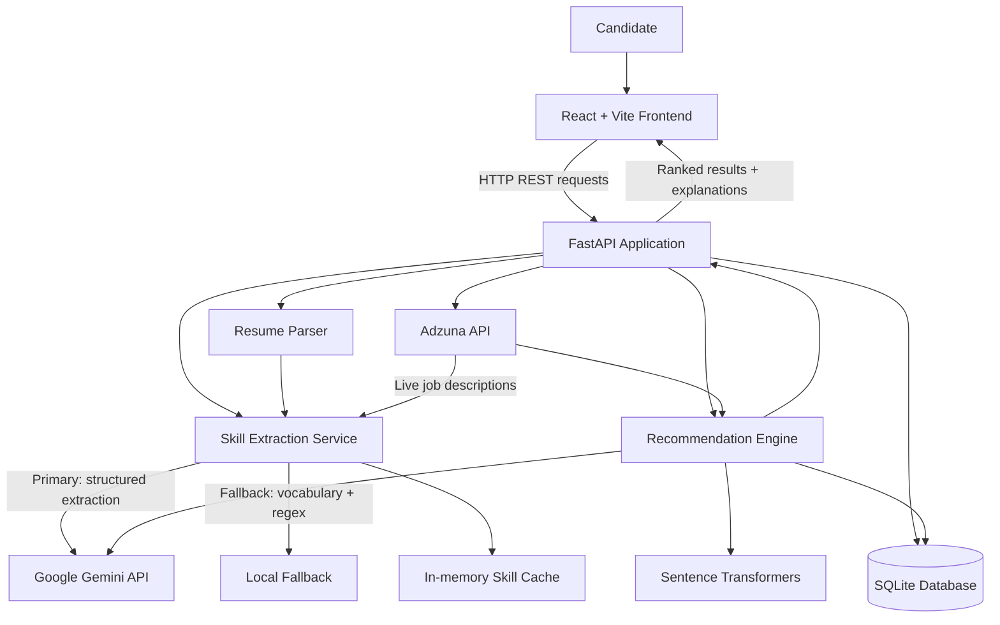

# CareerMatch AI — LLM-Powered Job Recommendation System

CareerMatch AI is an end-to-end job recommendation platform that analyzes a candidate's resume, identifies relevant skills, retrieves job opportunities, and ranks them according to how closely they match the candidate's profile.

The application combines **semantic search**, **skill-based matching**, and **LLM-assisted skill extraction and explanations**. It supports both a local sample-job dataset and live job listings retrieved from the Adzuna API.

> **Project status:** Portfolio/demo application. Match scores are ranking signals, not probabilities of getting hired or guarantees of job suitability. Review each job description before applying.

---

## Table of Contents

- [Highlights](#highlights)
- [Technology Stack](#technology-stack)
- [System Architecture](#system-architecture)
- [Recommendation Workflow](#recommendation-workflow)
- [Matching Algorithm](#matching-algorithm)
- [LLM Integration and Fallback Strategy](#llm-integration-and-fallback-strategy)
- [Project Structure](#project-structure)
- [Getting Started](#getting-started)
- [Environment Variables](#environment-variables)
- [API Reference](#api-reference)
- [Data Model](#data-model)
- [Current Limitations](#current-limitations)
- [Possible Improvements](#possible-improvements)

## Highlights

### Resume analysis
- Upload a resume in **PDF, DOCX, or TXT** format.
- Extract text from the uploaded document.
- Identify technical and professional skills using Gemini, with a local vocabulary-based fallback.
- Save candidate profile information and extracted skills in SQLite.

### Personalized job recommendations
- Generate text embeddings using Sentence Transformers `all-MiniLM-L6-v2`.
- Compare the candidate's resume with job descriptions using cosine similarity.
- Combine semantic similarity with skill overlap to rank jobs.
- Display matched skills, missing skills, score components, and a short explanation for each recommendation.

### Live job search
- Retrieve current job listings from the **Adzuna API** using a job-title query and location.
- Extract skills from multiple job descriptions in a batch.
- Rank the retrieved jobs against the uploaded resume.
- Show job details, match scores, and the original application link when available.

### LLM efficiency and reliability
- Use Gemini for structured skill extraction and recommendation explanations.
- Cache successful skill-extraction results to avoid repeating identical requests.
- Batch job-description skill extraction to reduce the number of LLM calls.
- Fall back to local vocabulary/regex extraction when Gemini is unavailable or its quota is exhausted.
- Generate local recommendation explanations when an LLM response is unavailable.

---

## Technology Stack

| Layer | Technologies | Responsibility |
|---|---|---|
| Frontend | React, Vite, CSS | Resume upload, dashboard, job results and live search |
| Backend | Python, FastAPI | REST endpoints and application workflow |
| Resume processing | pypdf, python-docx | Extract text from PDF and DOCX files |
| NLP / embeddings | Sentence Transformers, all-MiniLM-L6-v2 | Convert resume and job text into vector representations |
| Matching | NumPy, cosine similarity | Calculate semantic and skill-based match scores |
| LLM | Google Gemini API | Structured skill extraction and match explanations |
| Database | SQLite, SQLAlchemy | Store candidate profiles and sample job records |
| External data | Adzuna API | Retrieve live job listings |

---

## System Architecture

The application follows a simple **React frontend → FastAPI backend → service layer → database / external APIs** architecture.

### High-level architecture



### Main components

| Component | File / module | Responsibility |
|---|---|---|
| Frontend | `frontend/src/App.jsx` | Resume upload, candidate state, local recommendations, live job search and results |
| API layer | `backend/app/main.py` | FastAPI routes, request handling, database access and orchestration |
| Database setup | `backend/app/database.py` | SQLAlchemy engine, session and declarative base |
| Data models | `backend/app/models.py` | Candidate, Job and Recommendation ORM models |
| Request schemas | `backend/app/schemas.py` | Pydantic validation for profile and job input |
| Resume parser | `backend/app/services/parser.py` | Extract text from PDF, DOCX and TXT files |
| Skill extraction | `backend/app/services/skills.py` | Gemini extraction, batching, caching and regex fallback |
| LLM integration | `backend/app/services/llm.py` | Gemini client, structured extraction, quota handling and explanations |
| Embedding service | `backend/app/services/embeddings.py` | Load the Sentence Transformer model and generate normalized embeddings |
| Recommendation engine | `backend/app/services/recommender.py` | Calculate scores, rank jobs and prepare explanations |
| Live job integration | `backend/app/services/adzuna.py` | Fetch job listings from Adzuna |
| Sample data | `backend/app/seed.py` | Populate the database with sample jobs |

### Request and data flow

1. The candidate uploads a resume through the React interface.
2. The frontend sends the file to `POST /api/resume/upload`.
3. FastAPI passes the file contents to the resume parser.
4. The skill extraction service identifies skills using Gemini where available. If Gemini cannot be used, it applies local vocabulary-based matching.
5. The candidate's extracted resume text and skills are stored in SQLite.
6. When recommendations are requested, the recommendation engine embeds the resume and each job description.
7. It calculates semantic similarity and, when job skills are available, skill overlap.
8. Jobs are sorted by their final match score. The API returns the ranked jobs, score breakdown, matched/missing skills and explanations.
9. For live search, the backend first fetches listings from Adzuna, extracts skills from the fetched descriptions in a batch, and then uses the same recommendation engine to rank them.

---

## Recommendation Workflow

### 1. Resume processing

Supported formats:
- PDF
- DOCX
- TXT

The parser extracts text from the uploaded file and passes it to the skill extraction service. The backend currently enforces a maximum upload size of **5 MB** and rejects unsupported formats or documents from which too little text can be extracted.

### 2. Skill extraction

The skill extraction service:
- Sends resume text or job-description text to Gemini for structured skill extraction when the API is available.
- Normalizes extracted skills to lowercase and removes duplicates.
- Checks an in-memory cache before making a repeated extraction request.
- Uses a predefined technical-skill vocabulary and regular expressions as a fallback.

For live job search, skills from multiple job descriptions are requested in a **single batch operation** rather than making a separate Gemini request for every job.

### 3. Embedding generation

The embedding service uses:

```text
sentence-transformers/all-MiniLM-L6-v2
```

It converts candidate resume text and job text into normalized vector embeddings. Since the vectors are normalized, their dot product can be used to calculate cosine similarity.

### 4. Ranking

The recommendation engine calculates a score for each job, sorts jobs in descending order, and returns the top results.

More details are provided in [Matching Algorithm](#matching-algorithm).

---

## Matching Algorithm

CareerMatch AI uses a hybrid ranking approach that considers both the overall meaning of the resume/job description and the overlap between their detected skills.

### Semantic similarity

Let:
- (C) = candidate resume text
- (J) = job title and description text
- (S) = cosine similarity between their embeddings

The semantic similarity is normalized from the cosine range ([-1, 1]) to ([0, 1]):

```text
Semantic Score = (S + 1) / 2
```

The result is then represented as a percentage.

### Skill overlap

Let:
- (CS) = set of skills extracted from the candidate's resume
- (JS) = set of skills extracted from the job description

```text
Skill Overlap = |CS ∩ JS| / |JS|
```

This measures the fraction of detected job skills that are also present in the candidate's extracted skills.

### Hybrid match score

When job skills are available:

```text
Final Score = 0.70 × Semantic Score + 0.30 × Skill Overlap
```

The final score is converted to a percentage.

**Fallback for jobs without detected skills:** if no job skills are available, the system uses the semantic score alone. It does not treat an empty skill list as a zero skill match.

The API also returns:
- `semantic_score`: semantic similarity component
- `skill_score`: skill overlap component, or `null` when job skills are unavailable
- `matched_skills`: skills shared by the candidate and job
- `missing_skills`: detected job skills not found in the candidate profile

> The 70/30 weighting is a project baseline, not a scientifically validated hiring metric. The score is useful for ordering opportunities and should not be interpreted as a probability of selection.

---

## LLM Integration and Fallback Strategy

Gemini is used for two main tasks:

1. **Structured skill extraction:** identify skills from resume text and job descriptions, returning structured JSON.
2. **Recommendation explanations:** generate a short explanation using the job title, company, match score, matched skills and missing skills.

To reduce unnecessary API usage and improve resilience:

- **Caching:** successful skill extraction results are stored in an in-memory cache, with a maximum of 500 entries.
- **Batch processing:** live job descriptions are submitted together for skill extraction.
- **Quota handling:** when a Gemini quota/rate-limit error is detected, further Gemini calls are disabled for the current backend process.
- **Local fallback:** vocabulary-based extraction and locally generated explanations keep the core recommendation workflow usable when Gemini is unavailable.

The application can therefore provide recommendations without Gemini, although local skill extraction may identify fewer skills than the LLM-based method.

---

## Project Structure

```text
CareerMatch-AI-LLM-Powered-Job-Recommendation-System/
│
├── backend/
│   ├── app/
│   │   ├── services/
│   │   │   ├── adzuna.py          # Fetch live jobs from Adzuna
│   │   │   ├── embeddings.py      # Sentence Transformer embeddings
│   │   │   ├── llm.py             # Gemini integration and fallback
│   │   │   ├── parser.py           # PDF, DOCX and TXT parsing
│   │   │   ├── recommender.py      # Similarity, scoring and ranking
│   │   │   └── skills.py           # Skill extraction, batching and cache
│   │   │
│   │   ├── database.py             # SQLAlchemy database configuration
│   │   ├── main.py                 # FastAPI application and endpoints
│   │   ├── models.py               # SQLAlchemy data models
│   │   ├── schemas.py              # Pydantic request schemas
│   │   └── seed.py                 # Sample job data
│   │
│   ├── .env.example                # Example environment configuration
│   └── requirements.txt            # Python dependencies
│
├── frontend/
│   ├── src/
│   │   ├── App.jsx                 # Main React application
│   │   ├── main.jsx                # React entry point
│   │   └── styles.css              # Application styling
│   ├── index.html
│   ├── package.json
│   └── vite.config.js
│
└── README.md
```

Local files such as `.env`, the SQLite database, virtual environments and `node_modules` should remain untracked.

---

## Getting Started

### Prerequisites

Install the following:

- Python 3.10 or later
- Node.js 18 or later
- npm
- Git
- Internet access on the first backend run to download the embedding model and to access configured external APIs

### 1. Clone the repository

```bash
git clone https://github.com/hamid559/CareerMatch-AI-LLM-Powered-Job-Recommendation-System.git
cd CareerMatch-AI-LLM-Powered-Job-Recommendation-System
```

### 2. Configure and run the backend

Open a terminal:

```bash
cd backend
python -m venv .venv
```

Activate the virtual environment.

**Windows PowerShell:**

```powershell
.venv\Scripts\Activate.ps1
```

**Windows Command Prompt:**

```bat
.venv\Scripts\activate
```

**macOS / Linux:**

```bash
source .venv/bin/activate
```

Install dependencies:

```bash
pip install -r requirements.txt
```

Create your local environment file by copying the example:

**Windows:**

```powershell
Copy-Item .env.example .env
```

**macOS / Linux:**

```bash
cp .env.example .env
```

Add the required API credentials as described below, then start FastAPI:

```bash
uvicorn app.main:app --reload
```

The backend runs at:

- API base: http://127.0.0.1:8000
- Interactive Swagger documentation: http://127.0.0.1:8000/docs
- Health check: http://127.0.0.1:8000/api/health

On startup, the application creates the database tables and seeds sample jobs.

### 3. Configure and run the frontend

Open a **second terminal** from the repository root:

```bash
cd frontend
npm install
npm run dev
```

Open the local URL printed by Vite. The current frontend configuration uses port **5174** (typically http://localhost:5174).

### 4. Try the application

1. Open the frontend in your browser.
2. Upload a PDF, DOCX or TXT resume.
3. Review the skills extracted from the resume.
4. Select **Find matching jobs** to rank the sample jobs stored in SQLite.
5. Enter a job title and location in the live-job section.
6. Select **Find Live Jobs** to fetch and rank Adzuna listings.

---

## Environment Variables

Create `backend/.env` using `backend/.env.example`.

| Variable | Purpose |
|---|---|
| `GEMINI_API_KEY` | API key for Gemini-based skill extraction and explanations |
| `GEMINI_MODEL` | Optional Gemini model name; code defaults to `gemini-2.5-flash` |
| `ADZUNA_APP_ID` | Adzuna application ID for live job search |
| `ADZUNA_APP_KEY` | Adzuna application key for live job search |
| `EMBEDDING_MODEL` | Optional Sentence Transformer model; defaults to `sentence-transformers/all-MiniLM-L6-v2` |

Keep real credentials in your local `.env` file. **Never commit API keys or paste them into public issues, screenshots, or source files.** The `.env.example` file should contain placeholders only.

Gemini is optional for the basic recommendation flow. Adzuna credentials are required for live job search. Without Gemini, the local skill-extraction and explanation fallbacks are used.

---

## API Reference

Base URL: `http://127.0.0.1:8000`

| Method | Endpoint | Description |
|---|---|---|
| GET | `/api/health` | Check whether the API is running |
| GET | `/api/jobs` | List jobs stored in the local database |
| POST | `/api/jobs` | Add a job to the local database |
| POST | `/api/resume/upload` | Upload and analyze a PDF, DOCX or TXT resume |
| POST | `/api/profile` | Create a candidate profile from supplied resume text |
| GET | `/api/candidates/{candidate_id}` | Retrieve a candidate profile and detected skills |
| GET | `/api/recommendations/{candidate_id}` | Rank locally stored jobs for a candidate |
| GET | `/api/jobs/live/{candidate_id}` | Fetch Adzuna jobs and rank them for a candidate |

### Example: Upload a resume

```bash
curl -X POST "http://127.0.0.1:8000/api/resume/upload" \
  -F "file=@resume.pdf"
```

The response includes a `candidate_id`, extracted skills and a short resume preview.

### Example: Get local recommendations

```bash
curl "http://127.0.0.1:8000/api/recommendations/1?top_k=10"
```

### Example: Search live jobs

```bash
curl "http://127.0.0.1:8000/api/jobs/live/1?query=Data%20Analyst&location=India&top_k=10"
```

The live endpoint fetches up to 20 Adzuna listings per request and returns the top ranked results, including application URLs when supplied by Adzuna.

For request/response schemas and interactive testing, use the Swagger page at `/docs`.

---

## Data Model

The SQLAlchemy models currently include:

### Candidate
- `id`: candidate identifier
- `name`: candidate name
- `resume_text`: extracted or supplied resume text
- `skills_csv`: comma-separated extracted skills
- `created_at`: profile creation timestamp

### Job
- `id`: job identifier
- `title`, `company`, `location`: job details
- `work_mode`, `experience`: role metadata
- `description`: job description
- `skills_csv`: comma-separated detected/entered skills
- `embedding_json`: stored job embedding

### Recommendation
A Recommendation ORM model is defined with candidate/job references, score and explanation fields. The current recommendation endpoints calculate and return ranked results directly; they do not currently persist each generated recommendation.

---

## Current Limitations

- The application is a local portfolio MVP and is not deployed as a production service.
- SQLite is used for straightforward local persistence.
- Skill extraction depends on the supplied resume/job text. The local vocabulary fallback can miss skills or fail to understand context.
- The in-memory skill cache is process-local and is cleared when the backend restarts.
- Gemini quota exhaustion disables further Gemini requests for the current backend process; restarting the process resets the local flag but does not restore the provider's quota.
- The live-job workflow depends on Adzuna API availability and credentials.
- The current scoring model focuses on semantic similarity and detected skill overlap. It does not yet personalize ranking using salary, experience level, location preferences or work-mode preferences.
- The ranking weights have not been validated against a human-labelled benchmark dataset.

---

## Possible Improvements

- Add user authentication, authorization and candidate data ownership.
- Move from SQLite to PostgreSQL and introduce database migrations.
- Add job deduplication and a scheduled job-ingestion pipeline.
- Add filters and ranking features for location, salary, experience and remote/hybrid preferences.
- Evaluate recommendations with a labelled dataset using Precision@K, Recall@K, MRR and NDCG.
- Add automated tests for parsing, skill extraction, scoring and API endpoints.
- Move long-running embedding and ingestion tasks to a background worker.
- Add persistent caching and monitoring for external API usage.
- Add privacy controls for viewing, exporting and deleting candidate data.

---

## Author

**Md Hamid**  
B.Tech, Chemical Engineering — IIT Patna

[GitHub](https://github.com/hamid559)
